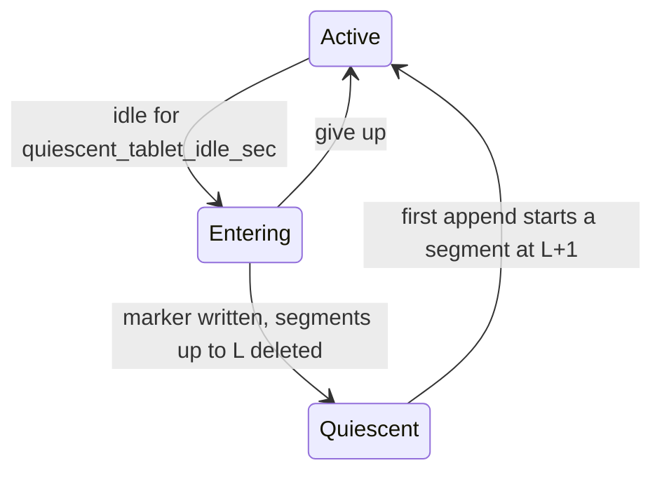

# Quiescent tablets

Status: in development.

## Motivation

A tablet that receives no operations for a while should bootstrap without reading or writing its WAL, and should keep no WAL on disk. Today every restart of such a tablet, graceful or not, reads and fsyncs WAL files even though all of its data is flushed.

With everything flushed, bootstrap still:

- Replays from `min(flushed op id, retryable requests op id)`. `TabletBootstrapStatePB` is flushed only from `pre_log_rollover_callback`, so replay starts near the beginning of the last segment (`SkipFlushedEntries`). In `many_tablets_bootstrap-itest`, 1000 tablets with 0.85 MB of flushed WAL each read 851 MB per restart.
- After a graceful restart, the last segment is closed, so `FinishBootstrap` creates a new segment, which costs a file fsync and a WAL directory fsync.
- After a non-graceful restart, the last segment has no footer, so `Log::ReuseAsActiveSegment` reads it in full to find its end and rebuild its footer and log index.

When nothing needs replay, the WAL provides only: the last and committed op id, orphaned replicates, retryable requests, the hybrid clock (`UpdateClock` per entry), the monotonic counter (`UpdateMonotonicCounter`) and the restart-safe time of the last entry. All of this fits in a small file.

Switching into and out of this mode is expected to be rare. Its cost is paid at the switch, not at every restart.

## Design: the marker replaces a log prefix

A quiescent tablet replaces its WAL segments with a small file, the quiescent marker. It is like the last included index and term of a Raft snapshot, where the flushed storages play the role of the snapshot.

The marker states: every op with index up to L is durable in every storage, and segments that hold ops up to L may be absent. Storages here are the regular DB, the intents DB, vector indexes, the superblock, consensus metadata and the retryable requests.

- **Used together with the segments.** The log is the marker followed by the segments that hold ops after L. Bootstrap starts from the marker's values and replays the segments on top, so each value is the max of the two. Segments whose max index is at most L are leftovers and are deleted when the log opens.
- **Valid after leaving the mode.** New appends only add ops after L, so the marker stays true. Nothing deletes it on the first append. GC may later delete segments after L as usual, and the marker is then only a lower bound.
- **Rewritten on re-entry.** Entering the mode again overwrites it with a larger L.
- **Removed with the WAL directory.** Tablet delete, tombstone and the remote bootstrap destination replace the directory and the marker with it.

The tablet is quiescent when the marker exists and there are no segments (`TabletPeer::IsQuiescent`). The first append after that starts a new segment at L+1.

A restart in the quiescent state reads no WAL. Any append returns the tablet to active without touching the marker.

## Marker contents and location

`QuiescentMarkerPB` (`log.proto`) holds what bootstrap would otherwise take from the WAL, plus a guard.

| Field | Used for |
| --- | --- |
| `tablet_id` | Rejecting a marker that came with another tablet's files |
| `op_id` (L) | `last_id` and `last_committed_id` in `ConsensusBootstrapInfo`; lookup of the op preceding the first append |
| `hybrid_time` of L | `clock->Update`, `MvccManager::SetLastReplicated` |
| `monotonic_counter` | `Tablet::UpdateMonotonicCounter`; the counter exists only in replicate messages |
| `entry_time` of the batch with L | `RetryableRequests::Clock().Adjust` |
| `last_segment_sequence_number` | Numbering of the next segment |

The file is `quiescent_marker` in the WAL directory, next to the bootstrap state file, so it shares the directory's lifecycle. `IsLogFileName` does not match it, so `LogReader` skips it. It is a PB container: `pb_util::WritePBContainerToPath` writes it to a temp file, fsyncs it, renames it and fsyncs the directory. The container header embeds only the descriptors of the types the message reaches (#35791), here `QuiescentMarkerPB` and `OpIdPB`, so the file stays under 1 KB, and `yb-pbc-dump` can print it.

## Entering the mode

A replica enters the mode after nothing was appended to its log for `quiescent_tablet_idle_sec` (default 600). `TSTabletManager` keeps a priority queue of tablets ordered by when each could enter the mode: its last append time plus the idle period. A background task wakes for the earliest one, and at least once a minute, or once per idle period if that is shorter, to pick up new tablets and `quiescent_tablet_idle_sec` raised from 0. It starts only after the tserver has processed a master heartbeat response: until then xCluster reports no WAL retention, so a producer tablet could delete WAL that its consumer still needs. Queued check times are not recomputed when a flag changes, so lowering `quiescent_tablet_idle_sec` or enabling `enable_quiescent_tablets` reaches an existing tablet at its next queued check, up to one old idle period later. It calls `TabletPeer::MaybeEnterQuiescentMode` for each due tablet, which tries to enter and returns the tablet's next check time. A failed attempt is retried after another idle period.

**Preconditions**, all checked on the replica in `TabletPeer::EnterQuiescentMode`:

1. The tablet is neither the sys catalog nor a transaction status tablet (see [Scope](#scope-and-open-questions)).
2. Committed op id and last received op id are both L, and no operations are pending. An operation stays in the operation tracker until it is applied, so this also means L was applied.
3. No Raft config change is pending.
4. Every peer has L. The leader tracks this as `all_replicated_op_id` in `PeerMessageQueue` and, while the AutoFlag is on, sends it in `ConsensusRequestPB.all_replicated_op_id`. A peer behind L could otherwise only catch up through remote bootstrap. So a peer that stays down keeps the tablet out of the mode until it is removed from the config, after `follower_unavailable_considered_failed_sec`.
5. The transaction participant has loaded the transactions from the intents DB after start, and has none, including applied ones still waiting for intent cleanup.
6. No CDC or xCluster streams on the tablet: the xCluster and CDC retention index (`Log::GetXReplMinReplicatedIndex`) is unset, and there is no table-level WAL retention (`wal_retention_secs`, which CDC stream setup sets).
7. No log anchors: remote bootstrap sessions and split parents anchor the segments.
8. The AutoFlag is promoted (see [Upgrade and rollback](#upgrade-and-rollback)).

**Steps**, each durable before the next:

1. Flush the regular and intents memtables and every vector index. Then `Tablet::EarliestNeededLogIndex` must report that no storage needs the WAL.
2. Flush the superblock, so `LastFlushedChangeMetadataOperationOpId` covers L with lazy superblock flush. Raft already flushes consensus metadata when the term or the committed config changes.
3. Flush the retryable requests up to L. They are stored in the bootstrap state file (`retryable_requests`, `TabletBootstrapStateFlusher::FlushBootstrapState`) together with `min_replay_txn_first_write_ht`. If an async flush is still running, the call returns `AlreadyPresent` and entry gives up.
4. `Log::CloseActiveSegment` submits `CLOSE_SEGMENT_MARKER` to the appender thread. If the last appended op is still L, the appender drops a preallocated segment, syncs and closes the active segment, and leaves the log with no active segment. It returns the marker values of L. Otherwise entry gives up.
5. `Log::WriteQuiescentMarker` writes the marker and publishes it in memory. It and step 6 hold `log_copy_mutex_` and refuse a closed log, and `Log::Close` waits for them, because remote bootstrap may delete and recreate the WAL directory of a closed log.
6. Check the log anchors again, then delete the segments covered by the marker (`Log::DeleteSegmentsCoveredByQuiescentMarker`).

Giving up before step 5 needs no undo; the flushes are harmless. An append that arrives after step 4 creates a new segment at L+1, which step 6 leaves alone, and the marker stays valid. A crash between steps 5 and 6 or one that loses the deletions, or an anchor found in step 6, leaves old segments next to the marker; `Log::Init` deletes them.

The second anchor check orders entry with remote bootstrap. A session anchors the log, then reads the marker, then makes the RocksDB checkpoint. Entry publishes the marker, then checks anchors. So either entry sees the anchor and keeps the segments, or the session reads the new marker and its checkpoint is made after the flush in step 1. In the second case entry may be deleting the segments while the session lists them, so the session leaves the segments that its marker covers out of the WAL it ships; the destination's `Log::Init` would delete them anyway.

## Leaving the mode

The first append creates a new segment starting at L+1 and writes to it; the marker is not touched. The append can be a leader replicate, the `NO_OP` of a new term, or a follower's `UpdateConsensus`. The segment has the initial segment size, as after a restart, not the size the segments had grown to.

This relies on lazy segment allocation, which also helps restarts outside this mode:

- The log stays in `kLogWriting` without an active segment. `Log::DoAppend` starts a segment for the first batch that has data. Rollover markers and sync do nothing without an active segment.
- `EnsureSegmentInitialized`, called from `FinishBootstrap`, no longer allocates a segment. It still reuses an unclosed last segment eagerly, because its scan in `ReuseAsActiveSegment` would otherwise land on the write path.
- A log opened with `CreateNewSegment::kTrue` still allocates a segment at open.

The first append pays for creating the file, writing the header, and a file and directory fsync. In the bootstrap profile this was 2.2 ms per tablet.

## Bootstrap with a marker

If the WAL directory has a marker, bootstrap treats the tablet as existing even without segments. It opens the log in place even with `skip_wal_rewrite=false`: that legacy mode moves the WAL directory aside, rewrites the replayed entries into a new log and deletes the old directory, which would lose the marker. Tablets enter the mode only with the default `skip_wal_rewrite=true`, so this matters only if the flag is changed later. A marker that is unreadable or for another tablet fails bootstrap with `Corruption`, because the segments it replaces may be gone.

- **Replay bounds.** Each storage's flushed op id is taken as `max(frontier, L)`: regular, intents and every vector index. Frontiers can be below L because trailing `NO_OP` and config ops do not advance them.
- **Replay state.** The last and committed op ids are at least L. If nothing is replayed, both are L. The first replayed entry can be after L+1, because GC may have deleted segments after L.
- **Restored values.** The hybrid clock, the MVCC last replicated time and the monotonic counter take the max of the marker value and the replayed values. The retryable requests clock is adjusted to the time of the last replayed entry, or to the marker's time if nothing is replayed.
- **No new segment.** The log has no active segment until the first append.
- **Restores.** Snapshot restore and PITR run as a Raft op on the tablet, at an index above L, so the tablet leaves the mode, and the restore forces the flushed frontiers to that op's id. Raising the frontiers to L therefore never skips restored data. Anything that sets a frontier below L on a tablet with a marker must also remove the marker.

## Running with no segments

`Log::Init` loads the marker and sets the last appended and last synced op ids to L. Remote bootstrap waits on them in `WaitForSafeOpIdToApply`, and memtable flushes compare against them.

**Lookup of L.** `LogCache::Init` keeps only the next index, and a cache miss used to fall back to `LogReader::LookupOpId`. After an election the first AppendEntries needs L as its preceding op. If that lookup failed, peers would be sent to remote bootstrap. `LogCache::LookupOpId` now calls `Log::LookupOpId`, which answers for L from the marker.

**Code that assumed an active segment:**

| Place | Change |
| --- | --- |
| `Log::Close` | Closes the active segment only if there is one |
| `Log::DoSync` | Without an active segment, clears the pending sync state |
| `Log::UpdateSegmentReadableOffset` | Updates the reader only for an active segment |
| `Log::CopyTo` | Skips the last segment only if it is active, i.e. has no footer |
| Rollover markers | Already did nothing for an empty or missing active segment |
| `Log::GetMinReplicateIndex` | L+1 after closing the active segment or loading the marker, so ops up to L are not reported as available |
| `Log::MinAnchorableIndex` | L, so a quiescent follower at L stays eligible as a remote bootstrap source and can anchor the leader's log at L |

`log_min_seconds_to_retain` and `log_min_segments_to_retain` do not apply to a quiescent tablet.
A table-level `wal_retention_secs` keeps its tablets out of the mode.

## Components that copy the WAL

Anything that copies or links WAL segments must also carry the marker. Otherwise the copy has data at L and a log that starts after it, with no record of L.

- **Remote bootstrap.** The source reads the marker right after anchoring the log and before the RocksDB checkpoint, and sends it in `BeginRemoteBootstrapSessionResponsePB.quiescent_marker`. The destination writes it into the new WAL directory before downloading segments.
- **Split.** `Log::CopyTo` hard-links segments into the child WAL directories and writes the marker with the child's tablet id. The `SPLIT_OP` is itself an append, so the parent has left the mode by then. The child's frontiers can still be below L, so it still needs the marker.
- **yb-data-patcher.** `add-time` and `sub-time` rebuild each WAL directory from its segments, so they also copy the marker, with its hybrid time shifted like those of the WAL entries. Bootstrap updates the clock with that hybrid time.

## Upgrade and rollback

Rolling back to a binary that ignores the marker corrupts the tablet. The old binary would see data at L and an empty log, and Raft would assign indexes from 1 again.

- Entering the mode is gated by the AutoFlag `enable_quiescent_tablets` of class `kLocalPersisted`. It is promoted at upgrade finalization, after which rollback is not possible. The same promotion guarantees that remote bootstrap destinations understand the `quiescent_marker` field.
- Bootstrap always honors an existing marker, whatever the flag says.
- `quiescent_tablet_idle_sec=0` stops tablets from entering the mode. Tablets that already have a marker are not affected.

## Scope and open questions

The first version excludes the sys catalog and transaction status tablets, since there are few of them. It also does not enter the mode when any of these is set: `skip_wal_replay_from_beginning_with_cdc=false`, `skip_wal_rewrite=false`, `force_recover_flushed_frontier`, or `enable_flush_retryable_requests=false`.

A CDC or xCluster stream created on a quiescent tablet reads ops after L. One that starts from an earlier checkpoint without a bootstrap gets `NotFound` for the ops up to L, as for WAL that GC deleted, so the setup needs a bootstrap even for a small table that used to keep all its WAL.

Open questions:

- [ ] Default for `quiescent_tablet_idle_sec`. Each entry flushes memtables and so creates small SST files. A tablet written about once per idle period enters and leaves the mode every period; at once per 10 minutes that costs too little to back off the idle threshold.
- [ ] With `durable_wal_write=false`, a peer can ack L before fsync. After an OS crash it may lose L and need remote bootstrap. Is that acceptable as the fallback?
- [ ] Allow CDC and xCluster streams whose checkpoints are all at or past L. Reads from checkpoint L also need the lookup of L.
- [ ] Add a flag that keeps segments for debugging with `log-dump`. The marker already allows segments up to L to remain.

## Testing and measurement

- **Log.** `log-test`: lazy segment allocation, closing the active segment, a marker with no segments, leftover segments up to L, a log continued after the marker, and dropping a preallocated segment.
- **Cluster.** `quiescent_tablet-itest`: graceful and abrupt restarts with RF3 and RF1, including a tablet with no data, and no remote bootstrap after the elections. Remote bootstrap from a quiescent leader and from a quiescent follower, which anchors the leader's log at L. Split of a quiescent tablet. No marker while the AutoFlag is off.
- **Not covered yet.** Sync point crashes between entry steps, and an append racing with entry.
- **Benchmark.** Run `many_tablets_bootstrap-itest` with graceful and non-graceful restarts. Compare restart time, bytes read and written, and fsync count with and without the mode.
